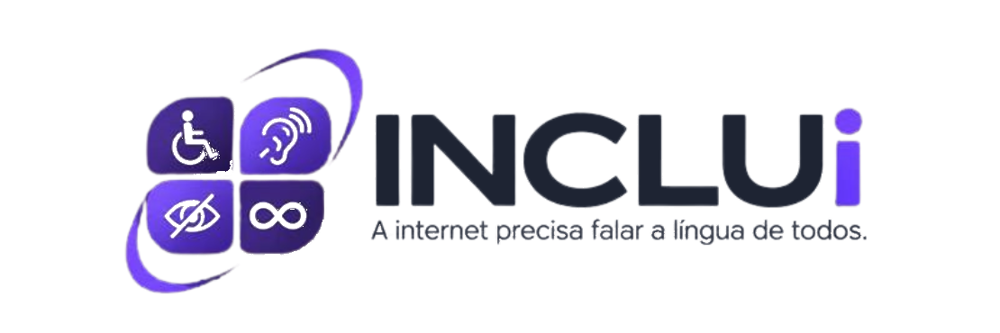

# INCLUI

Projeto front-end estático em HTML, CSS e JavaScript, desenvolvido para facilitar o acesso a informações e serviços públicos com linguagem clara, visual acessível e suporte a diferentes formas de leitura e compreensão.

## Descrição do problema, propósito e solução

O INCLUI nasceu para responder a um problema real: muitas pessoas encontram barreiras ao buscar informações e serviços do governo, sobretudo quando a interface digital é pouco acessível, confusa ou pouco clara.

A proposta do projeto é aproximar as pessoas de orientações sobre saúde, educação, serviços digitais e cidadania, usando uma experiência simples, acessível e intuitiva. A solução desenvolvida apresenta conteúdos organizados, recursos de acessibilidade, explicações em linguagem compreensível e caminhos práticos para facilitar a navegação.

---

## Tecnologias utilizadas

- HTML5
- CSS3
- JavaScript
- LocalStorage para salvar preferências de acessibilidade no navegador
- Recursos de acessibilidade como leitura em voz alta, contraste, VLibras e ajustes visuais
- Arquivos estáticos e organização em pastas específicas

---

## Estrutura de pastas

```text
gs_inclui/
├── index.html
├── sobre.html
├── integrantes.html
├── faq.html
├── contato.html
├── vacinacao.html
├── cursos-gratuitos.html
├── servicos-digitais.html
├── css/
│   └── style.css
├── js/
│   └── script.js
├── assets/
│   ├── icons/
│   └── images/
│       ├── ana.png
│       ├── duda.png
│       ├── mari.png
│       ├── vitor.png
│       ├── logo.png
│       └── logo-escuro.png
├── README.md
```

---

## Páginas principais

- `index.html` — página inicial com apresentação do projeto, acessibilidade, guia e destaque para as principais áreas
- `sobre.html` — visão geral do INCLUI e sua proposta
- `integrantes.html` — apresentação da equipe
- `faq.html` — perguntas frequentes
- `contato.html` — formulário de contato com simulação de envio
- `vacinacao.html` — guia sobre vacinação no SUS
- `cursos-gratuitos.html` — orientações sobre cursos gratuitos do Aprenda Mais
- `servicos-digitais.html` — guia para acessar serviços do gov.br e entender requisitos

---

## Como executar o projeto

### Opção 1
Abra o arquivo `index.html` em qualquer navegador.

### Opção 2
Use um servidor local simples:

```bash
python -m http.server 8000
```

Depois acesse:

```text
http://localhost:8000
```

---

## Autores e identificação

### Ana Julia Castilho Soares
- RM: 576018
- Turma: 1TDSPS
- GitHub: https://github.com/AnaJu1203
- LinkedIn: https://www.linkedin.com/in/ana-julia-castilho-13b8a02b3

### Maria Eduarda Alcantara dos Santos
- RM: 575092
- Turma: 1TDSPS
- GitHub: https://github.com/DuAlcantara
- LinkedIn: https://www.linkedin.com/in/maria-eduarda-alcantara-dos-santos-213596389/

### Mariana da Silva Freitas
- RM: 574261
- Turma: 1TDSPS
- GitHub: https://github.com/Mari1916
- LinkedIn: https://www.linkedin.com/in/mariana-freitas-3b756433a

### Vitor Hugo Silva Rodrigues
- RM: 575804
- Turma: 1TDSPS
- GitHub: https://github.com/VitorHugo226
- LinkedIn: https://www.linkedin.com/in/vitor-hugo-rodrigues-765921300/

---

## Imagens do projeto




---

## Repositório GitHub

Link oficial do projeto:

https://github.com/Mari1916/gs_inclui

---

## Contato

Para falar com a equipe, utilize a página de contato do projeto em `contato.html` ou abra uma issue no repositório oficial do GitHub.

---

## Observações importantes

- O projeto é um front-end estático, com HTML, CSS e JavaScript.
- Não há backend, autenticação, banco de dados ou integração com servidor.
- As preferências de acessibilidade são salvas apenas no navegador por meio do `localStorage`.
- Os conteúdos e links externos devem ser conferidos na fonte oficial antes de uso final.

---

## Conclusão

O INCLUI tem como objetivo tornar a informação pública mais clara, acessível e útil para diferentes perfis de usuários, promovendo maior autonomia digital e inclusão.
